<p align="center">
  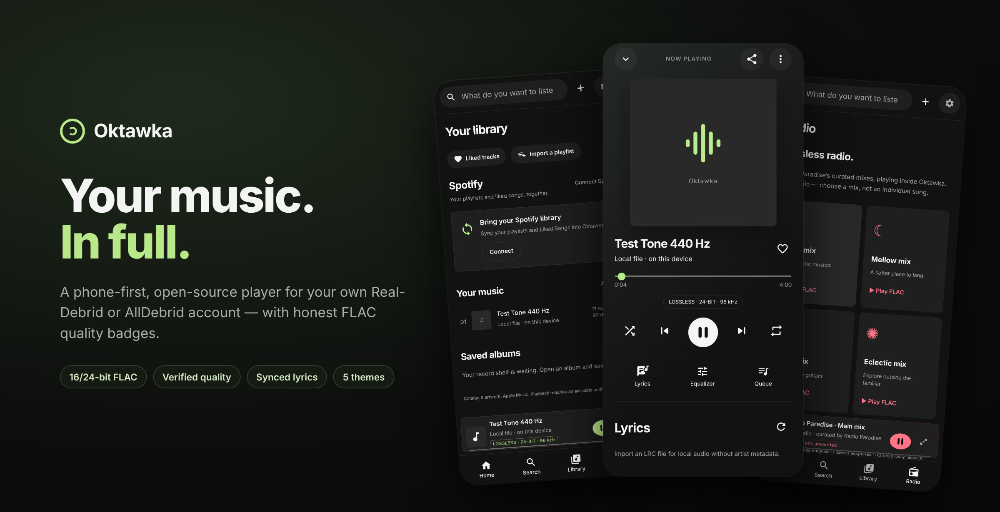
</p>

<h1 align="center">Oktawka</h1>

<p align="center">
  <b>Your music. In full. On your phone.</b><br>
  A clean, open-source music player for your own <b>Real-Debrid</b> or <b>AllDebrid</b> account,<br>
  with FLAC playback and quality badges that only claim what they can verify.
</p>

<p align="center">
  <a href="LICENSE"></a>
  
  
  
  
</p>

<p align="center">
  <a href="#-screenshots">Screenshots</a> ·
  <a href="#-features">Features</a> ·
  <a href="#-how-streaming-works">How it works</a> ·
  <a href="#-get-oktawka">Get it</a> ·
  <a href="#-whats-tested">What's tested</a> ·
  <a href="#%EF%B8%8F-development">Development</a>
</p>

---

## ✨ Why Oktawka

- **Built for phones first.** Four tabs, a compact mini-player and big touch targets. The desktop layout puts the player and lyrics side by side.
- **Honest quality.** `LOSSLESS · 24-BIT · 96 kHz` appears only after the app has read the real audio header. Live streams and unreadable sources say *unverified*, and lossy fallback is always labeled.
- **Your account, your library.** Connect your own debrid account. Keys stay on your device. No music, keys or subscriptions come bundled.
- **Light on battery by design.** Native playback comes first. The FLAC compatibility decoder loads only when it's needed, and the EQ is off by default. *(Battery use has not been measured yet.)*

## 📸 Screenshots

<table>
  <tr>
    <td align="center" width="33%">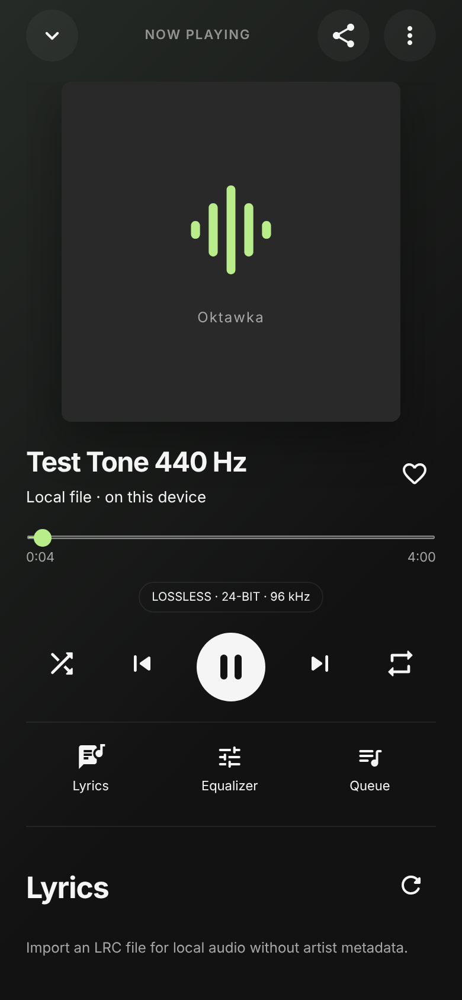<br><sub><b>Now Playing</b><br>Verified 24-bit / 96 kHz FLAC</sub></td>
    <td align="center" width="33%">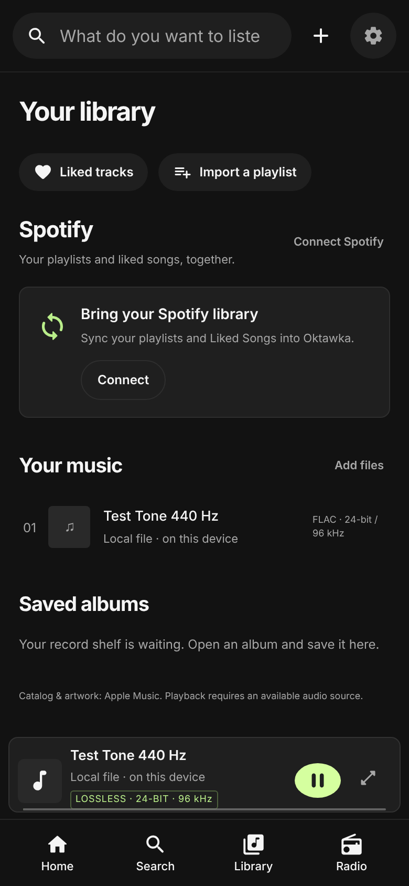<br><sub><b>Your library</b><br>Liked tracks, imports, saved albums</sub></td>
    <td align="center" width="33%">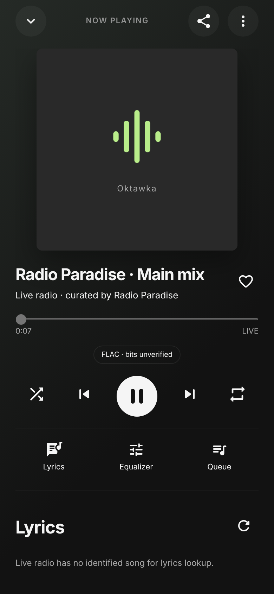<br><sub><b>Lossless radio</b><br>Live FLAC, honestly <i>unverified</i></sub></td>
  </tr>
  <tr>
    <td align="center">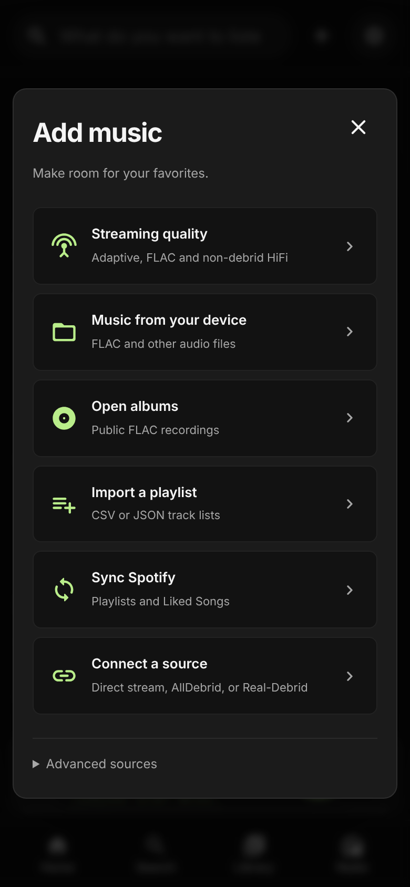<br><sub><b>Add music</b><br>Debrid, device files, open albums</sub></td>
    <td align="center">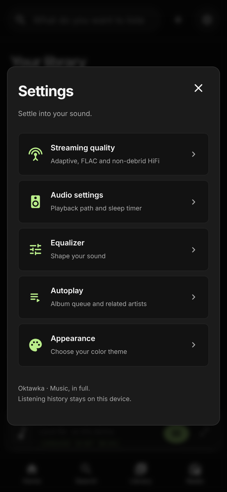<br><sub><b>Settings</b><br>Quality, audio path, autoplay</sub></td>
    <td align="center">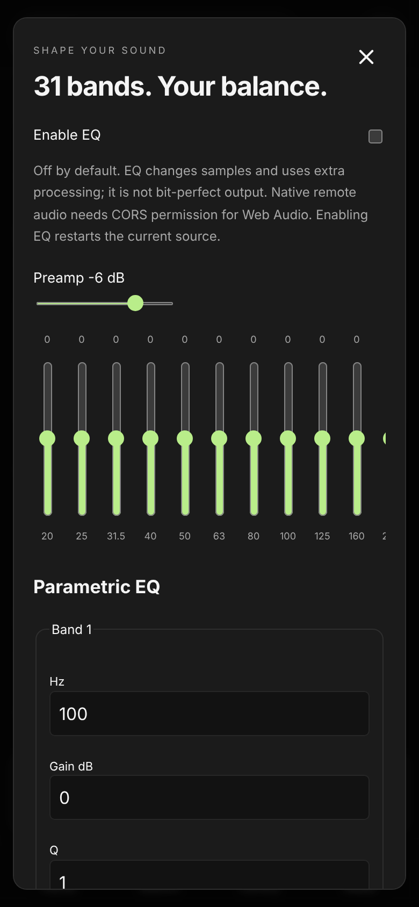<br><sub><b>Equalizer</b><br>Optional 31-band + parametric</sub></td>
  </tr>
</table>

### Five themes

<p align="center">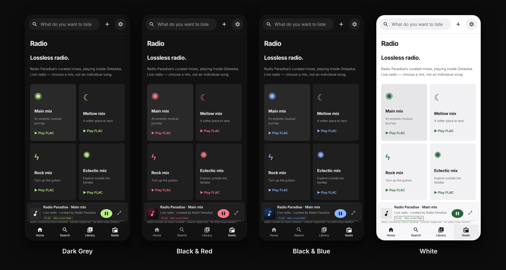</p>
<p align="center"><sub>Dark Grey · Black &amp; Red · Black &amp; Blue · White · plus the Original Green palette in the picker</sub></p>

<p align="center">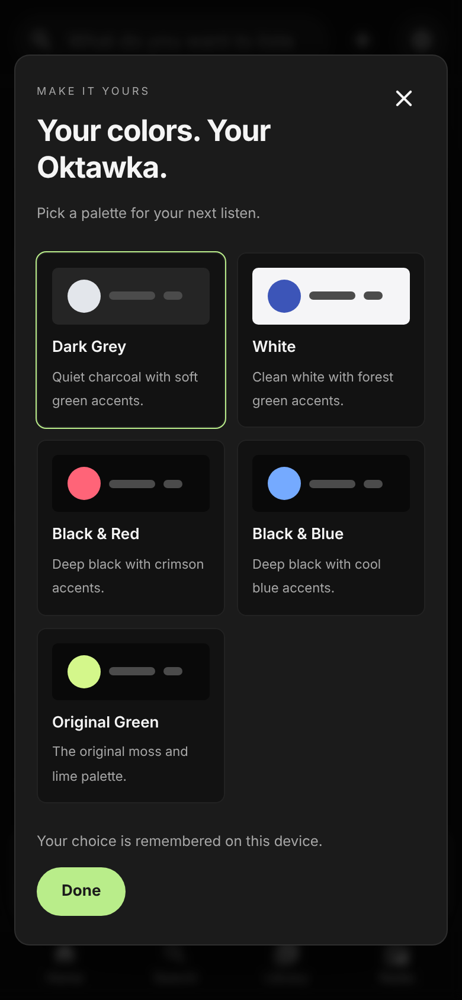</p>

### On desktop

<p align="center">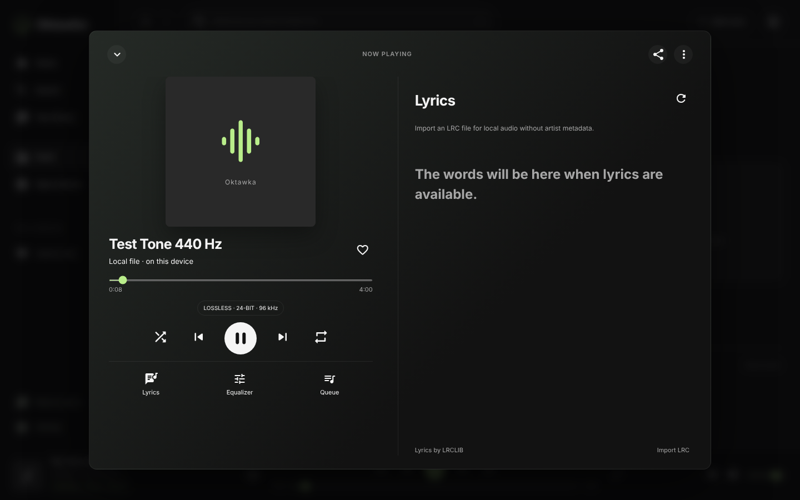</p>
<p align="center">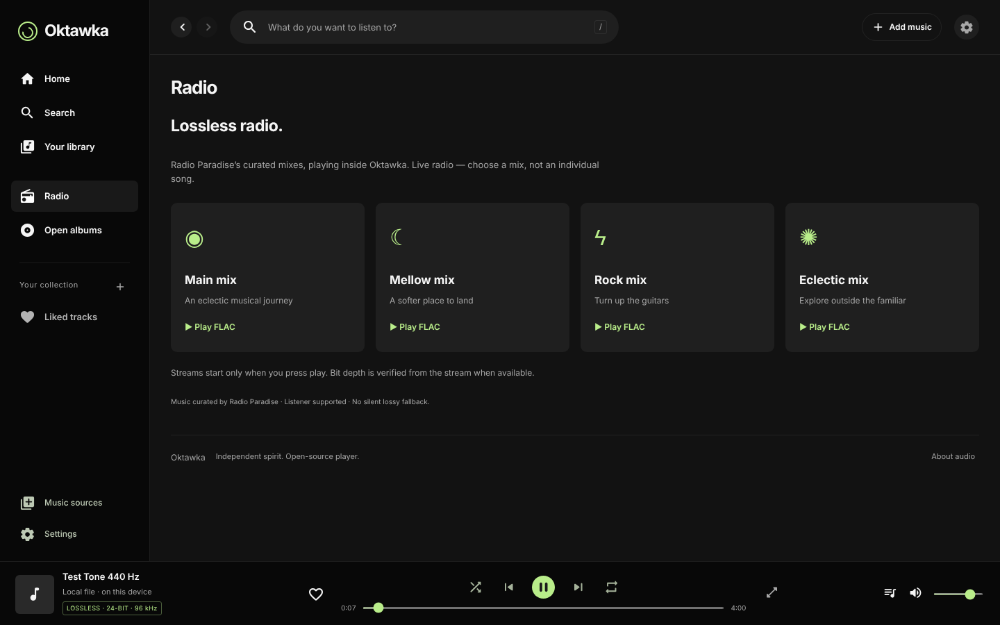</p>

> [!NOTE]
> **These screenshots are real.** They were captured from the current web build in Chromium (phone 390 × 844, desktop 1440 × 900) while audio was actually playing. The audio was a generated 24-bit / 96 kHz FLAC test tone, imported as a local file, and the Radio Paradise live stream. They are not Android device captures and not mockups. Album artwork is left out on purpose, because catalog art belongs to its rights holders. The hero banner arranges three of these same captures.

## 🎧 Features

| | Feature | What it does today |
| :-: | --- | --- |
| 🎼 | **FLAC playback** | Plays 16-bit and 24-bit FLAC. Native playback first, with an optional libFLAC (WASM) decoder for compatibility. |
| ✅ | **Verified quality badges** | Bit depth and sample rate are read from the real header. Unverified and lossy sources are labeled as such. |
| 🔗 | **Debrid connections** | Connect your own **AllDebrid** or **Real-Debrid** account and play inside the app. See the [provider differences](#-how-streaming-works). |
| 💿 | **Albums and artists** | Album and artist search, artist profiles with discography, clickable artist names, saved albums. |
| ▶️ | **Album queue** | Moves through an album in order and keeps the album sheet open. You can let related artists keep playing after the queue ends. |
| 🎤 | **Lyrics** | Synced or plain lyrics from LRCLIB when a match exists. You can also import `.lrc` files manually. |
| ❤️ | **Library** | Liked tracks, listening history, CSV/JSON playlist import, optional Spotify library sync (metadata only). |
| 📻 | **More sources** | Lossless Radio Paradise radio, Internet Archive open recordings, files on your device, and an optional self-hosted HiFi endpoint. |
| 🎚️ | **Audio controls** | Shuffle, repeat, seek, sleep timer, optional 31-band + parametric EQ. |
| 🎨 | **Themes** | Dark Grey, White, Black & Red, Black & Blue, Original Green. |
| 📱 | **Android app** | Lightweight WebView wrapper with bundled UI, safe-area spacing, Back handling and a media foreground service. |

## 🔌 How streaming works

1. Open **Add music → Connect a source** and connect your own debrid account.
2. Browse albums and artists, or pick a source.
3. Oktawka gets a playable audio link and plays it inside the app.
4. The player reads the audio header to show its quality, and lyrics appear when a match exists.

| Provider | Automatic album-track matching | Source / link workflow |
| --- | :-: | :-: |
| **AllDebrid** | ✅ | ✅ |
| **Real-Debrid** | ⏳ planned | ✅ |

Debrid services resolve sources. They are not music catalogs, so a catalog entry does not guarantee a playable file. Oktawka never swaps in a different recording just to get playback working. Only use sources you have permission to access.

<details>
<summary><b>FLAC and quality details</b></summary>

- Supported FLAC files keep their original 16-bit or 24-bit audio. Converting lossy audio to FLAC does not bring back lost detail.
- Verified badges come from supported audio headers or decoded audio. Quality reported by a provider is shown separately.
- Lossy fallback is opt-in where it is supported, and it is always labeled.
- Your browser, operating system or hardware may resample or downmix, so bit-perfect output is not guaranteed.
- Dolby Atmos, Sony 360 and segmented DASH are **not implemented**.
- The **HiFi** option needs your own working service backed by a Tidal account. This repository provides no credentials or public endpoint.

</details>

## 📲 Get Oktawka

**Android (sideload preview).** Download the APK from [Releases](../../releases) and check it against the attached `SHA256SUMS`. You need Android 8.0 or later and an up-to-date Android System WebView. This is a development-signed review build, not a Play Store release.

**Web / desktop preview.** Build and run it locally (see [Development](#%EF%B8%8F-development)). A public hosted version is planned.

## 🧪 What's tested

Every status is backed by evidence. [docs/ACCEPTANCE.md](docs/ACCEPTANCE.md) has the full item-by-item record.

| Area | Status |
| --- | --- |
| Automated checks: 21 test files, packaged Worker, Android asset bundle | ✅ Passing |
| Web build in phone and desktop Chromium: layout, Back handling, radio playback, local 24-bit FLAC with verified badge | ✅ Tested |
| FLAC 16/24-bit decoder (known samples, bit-exact) | ✅ Unit-tested |
| Real-Debrid / AllDebrid with real accounts | ⏳ Not yet tested (mocked APIs only) |
| Android on a real phone: insets, keyboard, Back, screen-off playback | ⏳ Not yet tested |
| HiFi endpoint | ⏳ Not yet tested |
| Battery use | ⏳ Not measured |

## 🛠️ Development

Requires **Node.js 22+**. No `npm install` needed.

```bash
node scripts/check.mjs
```

```bash
node scripts/build-worker.mjs
```

```bash
node tests/artifact.mjs
```

The Android build needs SDK platform 35 and build-tools 35.0.0. Read [`android/README.md`](android/README.md) for signing.

```bash
ANDROID_SDK_ROOT=/path/to/android-sdk bash android/build.sh
```

| Folder | Contents |
| --- | --- |
| `dist/` | Web UI and playback code (vanilla HTML/CSS/JS) |
| `worker/` | Metadata, lyrics, radio and provider-support routes |
| `android/` | Java WebView wrapper and build script |
| `tests/` | Playback, source and integration checks |
| `build/` | Generated Worker output (git-ignored) |

The server build targets a Worker-compatible host. GitHub Pages alone cannot run the `/api/*` routes. More in [CONTRIBUTING.md](CONTRIBUTING.md) and the [technical notes](docs/TECHNICAL-NOTES.md).

## 🗺️ Roadmap

- [ ] Real-phone pass: system bars, cutouts, keyboard, gesture and 3-button navigation
- [ ] Verified screen-off / background playback and lock-screen controls
- [ ] Real-Debrid automatic album matching (parity with AllDebrid)
- [ ] Measured battery and CPU use
- [ ] Signed Android release
- [ ] Public hosted web version

## 🔒 Privacy

You enter your own keys. They stay in memory unless you choose optional tab-scoped persistence. Your library lives on your device and is not backed up to any cloud. Lyrics lookup sends song title and artist to LRCLIB, never your debrid key. Please never post account keys, browser session exports or signed audio URLs in issues or screenshots. See [SECURITY.md](SECURITY.md) and the [privacy review](docs/PRIVACY-REVIEW.md).

## 🤝 Contributing

Bug reports and pull requests are welcome. Start with [CONTRIBUTING.md](CONTRIBUTING.md) and use the issue templates.

## 📄 License

[MIT](LICENSE). Bundled components keep their own licenses, including the FLAC decoder and Material icons ([notices](third-party/README.md)). This open-source license gives no rights to third-party music or catalogs.
